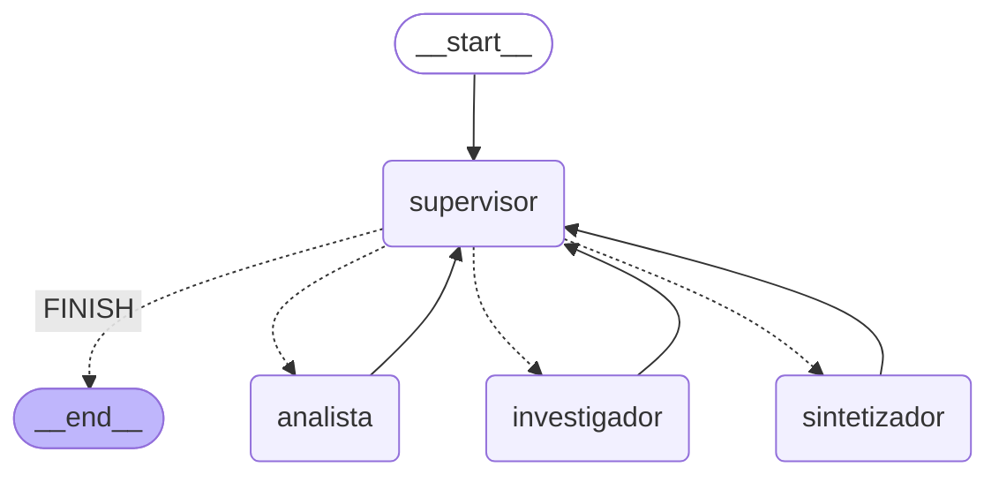

# Orquestador multi-agente especializado

Pre-entrega del módulo 6 de AI Engineering (Coderhouse).

Un **supervisor** coordina a tres agentes para responder consultas sobre productos que necesitan más de un dominio: el **investigador** busca en una base de productos y reseñas, el **analista** valida y calcula (sentimiento, estadísticas) y el **sintetizador** redacta la respuesta final. El supervisor decide en cada paso quién interviene, valida el resultado con una rúbrica y recién entonces finaliza.

```
Usuario: Investigá las reseñas de Aurora X y Brisa Mini, analizá el sentimiento y el
         puntaje promedio de cada uno y recomendame cuál conviene.

supervisor -> investigador   (busca fichas y reseñas)
supervisor -> analista       (valida las reseñas, calcula promedio y sentimiento)
supervisor -> sintetizador   (redacta la comparación y la recomendación)
supervisor -> FINISH         (el informe cumple la rúbrica)
```

## Demo

- [`demo.ipynb`](demo.ipynb): notebook ejecutado con el modelo real, con el flujo de delegación paso a paso (se ve en GitHub sin instalar nada).
- [`trazas/ejemplo_traza.json`](trazas/ejemplo_traza.json): traza completa de la consulta de arriba.
- [`trazas/ejemplo_producto_inexistente.json`](trazas/ejemplo_producto_inexistente.json): una consulta por un producto que no existe en la base.

## Diagrama del grafo

Generado con `graph.get_graph().draw_mermaid()` (se regenera con `python export_graph.py`).



Las líneas punteadas son aristas condicionales: el supervisor elige cuál seguir.

## Instalación

Hace falta Python 3.12.

```bash
python -m venv .venv
.venv\Scripts\activate        # en Linux/macOS: source .venv/bin/activate
pip install -r requirements.txt
```

Después copiar `.env.example` como `.env` y completar la API key del proveedor que se vaya a usar (`LLM_PROVIDER` elige entre `openai` y `anthropic`).

| Variable | Default | Descripción |
|---|---|---|
| `LLM_PROVIDER` | `openai` | `openai` o `anthropic` |
| `OPENAI_API_KEY` / `ANTHROPIC_API_KEY` | | Obligatoria la del proveedor elegido |
| `OPENAI_MODEL` / `ANTHROPIC_MODEL` | `gpt-5-mini` / `claude-opus-5-5` | Modelo de cada proveedor |
| `SUPERVISOR_MAX_STEPS` | `8` | Decisiones máximas del supervisor por consulta |
| `SUPERVISOR_MAX_ATTEMPTS` | `2` | Veces que un mismo agente puede intervenir |
| `GRAPH_RECURSION_LIMIT` | `40` | Techo de pasos del grafo completo |

## Uso

```bash
python main.py                                  # la consulta de ejemplo; guarda la traza en trazas/
python main.py "Compará el Teclado Forja K1 con los Auriculares Aurora X"
python main.py --provider anthropic
```

Los tests no usan API keys ni red: reemplazan los modelos por guiones.

```bash
pytest
```

## Estructura

```
state.py                  estado compartido (hereda de MessagesState)
agents/
  supervisor.py           el supervisor: decisión, rúbrica y salvaguardas
  research_agent.py       investigador y sus 3 herramientas
  analyst_agent.py        analista y sus 3 herramientas
  synthesis_agent.py      sintetizador (sin herramientas)
  common.py               qué ve cada agente y cómo se guardan sus aportes
graph.py                  el StateGraph
knowledge.py              base de productos y reseñas
data/productos.json       3 productos con 6 reseñas cada uno
runner.py                 ejecuta el grafo y registra el flujo
main.py                   consulta de ejemplo
export_graph.py           genera el diagrama Mermaid
demo.ipynb                notebook de la demo
trazas/                   trazas de ejecuciones reales
tests/
```

## Por qué esta topología

Elegí una **topología jerárquica con un supervisor** en lugar de agentes que se hablan entre sí, por tres motivos:

- **El flujo es auditable.** Todo pasa por el supervisor, así que cada decisión queda registrada con su razón (`decisiones` en el estado y en la traza). En una red de agentes que se llaman entre sí es difícil saber quién pidió qué.
- **Hay una sola autoridad para decidir cuándo se termina.** Eso evita que dos agentes se corrijan entre sí sin fin.
- **Las dependencias son claras.** El analista necesita los datos del investigador y el sintetizador necesita a los dos. El supervisor ordena esa secuencia y puede repetir un paso si el resultado no alcanza.

## Cómo funciona

**Estado compartido (`state.py`).** `OrchestratorState` hereda de `MessagesState` y agrega:

- `contribuciones`: lista (con reducer `operator.add`) donde cada agente deja su aporte con su nombre, el número de intento, la instrucción que recibió, su respuesta y los **datos crudos de sus herramientas**.
- `decisiones`: la bitácora del supervisor (destino, instrucción, razón y si una salvaguarda lo corrigió).
- `next_agent`, `instruccion`, `pasos`, `task_completed` y `respuesta_final`.

Como los datos crudos de las herramientas se guardan en el estado, el analista recibe las reseñas exactas que trajo el investigador y no un resumen que un modelo pudo deformar. Así no se pierde contexto entre agentes.

**Supervisor (`agents/supervisor.py`).** Es un modelo con salida estructurada: devuelve `siguiente` (`investigador`, `analista`, `sintetizador` o `FINISH`), una instrucción y la razón. La función `route_from_supervisor` devuelve ese valor con tipo `Literal` y el grafo lo usa como arista condicional. El prompt incluye una **rúbrica** con cuatro criterios que el supervisor aplica a cada resultado antes de avanzar o finalizar:

1. Completitud: cubre todos los productos y todos los puntos de la pregunta.
2. Evidencia: cada cifra viene de una herramienta, no de la memoria del agente.
3. Consistencia: los números del analista coinciden con los datos del investigador y el informe no contradice a ninguno.
4. Pertinencia: responde lo que se preguntó.

Si un resultado falla, el supervisor reenvía al mismo agente con una instrucción concreta de qué corregir.

**Agentes especialistas.** El investigador y el analista se crean con `create_react_agent` de LangGraph, cada uno con herramientas acotadas a su rol. El investigador no puede calcular y el analista no puede buscar, así que cada uno solo puede hacer lo suyo. El sintetizador no tiene herramientas: solo redacta con los aportes que recibe.

**Contexto acotado.** Un especialista no recibe el historial del sistema ni las decisiones del supervisor. Recibe tres cosas: la pregunta original, su tarea y los aportes previos. Hay un test que verifica que el razonamiento del supervisor no llega a los especialistas.

## Cómo se manejan los conflictos y los bucles

El riesgo de un supervisor es el "supervisor infinito": un bucle de correcciones sin fin. El modelo propone, pero unas **salvaguardas en código** corrigen lo que no corresponde:

| Situación | Qué hace el código |
|---|---|
| Un agente ya intervino `SUPERVISOR_MAX_ATTEMPTS` veces (por defecto 2, o sea una corrección) | No lo vuelve a llamar: pasa a la síntesis, o finaliza si ya hay informe |
| El supervisor eligió `FINISH` sin informe del sintetizador | Lo manda a redactar el informe primero |
| Se usaron `SUPERVISOR_MAX_STEPS` decisiones (por defecto 8) | Cierra la consulta con el informe |
| El grafo completo supera `GRAPH_RECURSION_LIMIT` pasos | Corta y devuelve un error en lugar de seguir gastando |

Cada ajuste queda anotado en el campo `ajuste` de la decisión, y se ve en la traza. Para los desacuerdos entre agentes, como números del analista que no coinciden con los datos del investigador, el supervisor es el árbitro: aplica el criterio de consistencia de la rúbrica y manda a corregir al agente que se equivocó. El sintetizador también tiene la instrucción de mencionar las contradicciones en vez de elegir un dato en silencio.

## Limitaciones

- El análisis de sentimiento usa un léxico fijo de palabras en español con manejo simple de negaciones. Es determinista, lo que sirve para verificar los cálculos, pero es menos preciso que un modelo. Por ejemplo, tiende a clasificar como negativas algunas reseñas de 3 estrellas con texto mixto, y el sintetizador lo advierte en el informe.
- La base de productos es un archivo JSON con 3 productos y 6 reseñas cada uno. Simula una fuente externa: para usar una búsqueda real habría que cambiar las herramientas del investigador (por ejemplo por Tavily).
- Con muy pocas reseñas por producto, los promedios son orientativos.
