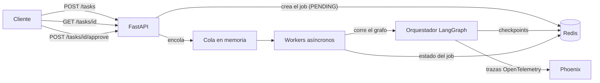
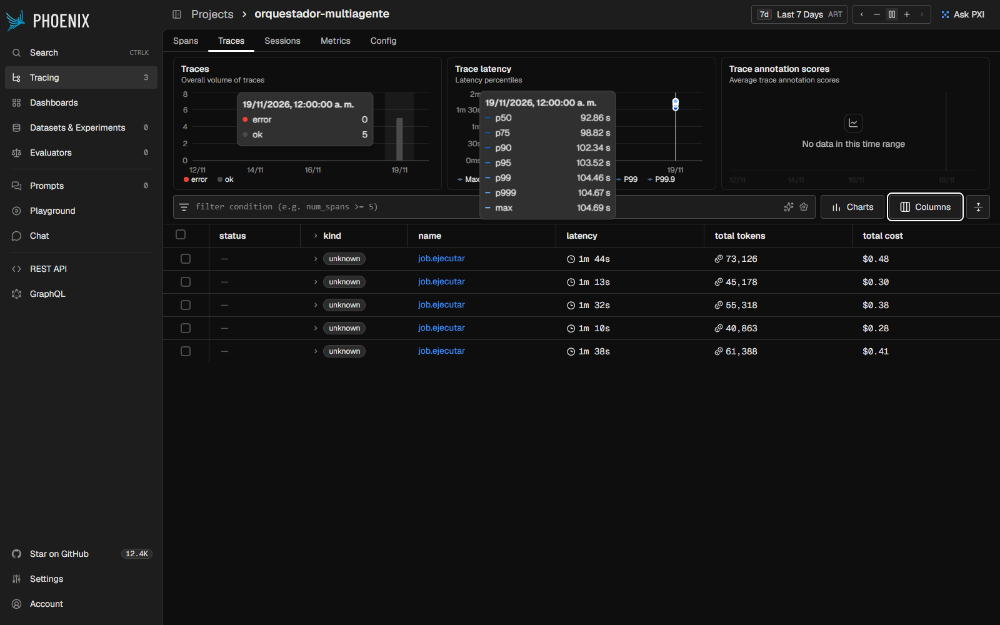
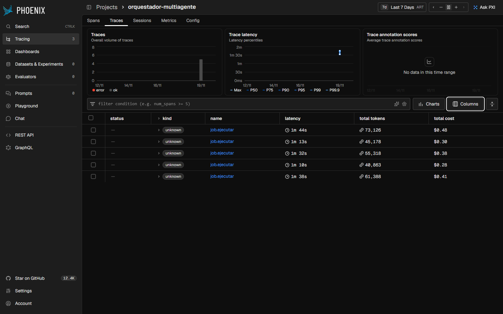

# API de producción y monitoreo activo

Pre-entrega del módulo 7 de AI Engineering (Coderhouse).

API REST (FastAPI) que expone el [orquestador multi-agente del módulo 6](../modulo-6-orquestador-multiagente/). Los endpoints no esperan al agente: encolan la tarea y devuelven un `job_id`. El estado de los jobs y los checkpoints del grafo viven en Redis, cada ejecución se traza en Arize Phoenix y las acciones con efectos secundarios se pausan hasta que una persona las aprueba.

```
POST /tasks  {"pregunta": "..."}   ->  202 {"job_id": "…", "status": "PENDING"}
GET  /tasks/{job_id}               ->  estado, flujo del grafo y resultado
POST /tasks/{job_id}/approve       ->  aprueba o rechaza una acción crítica en pausa
```

## Arquitectura



| Archivo | Qué hace |
|---|---|
| `app/main.py` | La API: `POST /tasks`, `GET /tasks/{id}`, `POST /tasks/{id}/approve`, `/outbox` y `/health` |
| `app/worker.py` | Cola y workers asíncronos. Ejecutan el grafo, actualizan el estado en Redis y capturan los errores |
| `app/jobs.py` | Estado de los jobs en Redis (PENDING, RUNNING, WAITING_APPROVAL, DONE, FAILED) |
| `app/graph.py` | El orquestador del módulo 6 con `AsyncRedisSaver` y el nodo de aprobación |
| `app/hitl.py` | Human-in-the-loop: propone la acción, pausa con `interrupt` y la ejecuta si se aprueba |
| `app/observability.py` | Conexión a Phoenix con OpenInference |
| `app/outbox.py` | Los emails "enviados" (simula un servicio de correo; se guardan en Redis) |
| `app/agents/`, `app/state.py` | Supervisor y agentes del módulo 6 |
| `scripts/load_test.py` | Prueba de carga: 5 peticiones concurrentes |
| `scripts/demo_hitl.py` | Demo del flujo de aprobación |
| `scripts/capture_screenshots.py` | Saca las capturas del dashboard a `screenshots/` |
| `docker-compose.yml` | Redis Stack, Phoenix y la API |

## Cómo levantarlo

Hace falta Python 3.12 y Docker.

**1. Dependencias y variables de entorno**

```bash
python -m venv .venv
.venv\Scripts\activate        # en Linux/macOS: source .venv/bin/activate
pip install -r requirements.txt        # lo necesario para correr la API
pip install -r requirements-dev.txt    # además: tests y capturas (opcional)
```

Copiar `.env.example` como `.env` y completar la API key del proveedor (`LLM_PROVIDER` elige entre `openai` y `anthropic`). `REDIS_URL` ya apunta a `localhost`.

**2. Redis y Phoenix**

```bash
docker compose up -d redis phoenix
```

El checkpointer de LangGraph necesita **Redis Stack** (los módulos RediSearch y RedisJSON), que es lo que trae la imagen `redis/redis-stack-server`. Un Redis común no alcanza. Phoenix queda en http://localhost:6006.

**3. La API**

```bash
uvicorn app.main:app --port 8000
```

La documentación interactiva está en http://localhost:8000/docs. Para levantar también la API en Docker: `docker compose up -d --build`.

**4. Probarla**

```bash
curl -X POST localhost:8000/tasks -H "content-type: application/json" \
     -d '{"pregunta": "Compará las reseñas de los Auriculares Aurora X y del Parlante Brisa Mini y recomendame uno."}'
curl localhost:8000/tasks/<job_id>
```

Los tests no usan Docker, Redis ni API keys: usan Redis falso (`fakeredis`) y modelos con guion.

```bash
pytest
```

### Variables de entorno

| Variable | Default | Descripción |
|---|---|---|
| `LLM_PROVIDER` | `openai` | `openai` o `anthropic` |
| `OPENAI_API_KEY` / `ANTHROPIC_API_KEY` | | Obligatoria la del proveedor elegido |
| `OPENAI_MODEL` / `ANTHROPIC_MODEL` | `gpt-5-mini` / `claude-opus-5-5` | Modelo de cada proveedor |
| `REDIS_URL` | `redis://localhost:6379/0` | Redis Stack |
| `PHOENIX_COLLECTOR_ENDPOINT` | | Endpoint de Phoenix. Vacío = sin trazas |
| `PHOENIX_PROJECT_NAME` | `orquestador-multiagente` | Proyecto de Phoenix donde caen las trazas |
| `WORKER_CONCURRENCY` | `5` | Tareas que corren a la vez |
| `JOB_TIMEOUT_S` | `300` | Tiempo máximo por tarea |
| `SUPERVISOR_MAX_STEPS` / `SUPERVISOR_MAX_ATTEMPTS` | `8` / `2` | Paradas del supervisor (módulo 6) |
| `GRAPH_RECURSION_LIMIT` | `40` | Techo de pasos del grafo |

## Endpoints asíncronos

`POST /tasks` valida la pregunta, crea el job en Redis (`PENDING`), lo encola y responde `202` con el `job_id` y la cabecera `Location`. No espera al agente. Los workers sacan los jobs de la cola y los ejecutan en el mismo event loop: las llamadas al modelo y a Redis son `async` y las herramientas sincrónicas del grafo corren en un hilo, así que ningún endpoint bloquea el event loop. Hay un test que verifica que `/health` sigue respondiendo en menos de 0,3 s mientras un job está en curso.

El cliente consulta `GET /tasks/{id}` hasta que el estado sea `DONE` o `FAILED`. La respuesta incluye `flujo`, con cada decisión del supervisor y cada aporte de los agentes.

## Estado en Redis

| Clave | Contenido |
|---|---|
| `job:{id}` | El job: estado, pregunta, resultado, error, acción pendiente |
| `job:{id}:flujo` | Lista con los pasos del grafo, en orden |
| `outbox` | Los emails enviados |
| `checkpoint:*` | Los checkpoints del grafo (`AsyncRedisSaver`), un hilo por job |

Los jobs expiran a los 7 días (`JOB_TTL_S`). **Si el agente falla en segundo plano, el worker captura la excepción y deja el job en `FAILED` con el motivo en `error`**, para que el cliente no quede esperando. Eso cubre tres casos, con un test cada uno: una excepción del modelo, el tiempo máximo (`JOB_TIMEOUT_S`) y el techo de pasos del grafo.

Al arrancar, la API revisa Redis: reencola los jobs que quedaron en `PENDING` y marca como `FAILED` los que estaban en `RUNNING` cuando se cayó.

## Human-in-the-loop

Para probar la pausa se agregó una acción con efectos secundarios: **enviar el informe por email**. El supervisor puede elegir el agente `ejecutor` solo si el usuario pidió esa acción, y solo después de que el sintetizador redactó el informe.

```
supervisor -> proponer_accion -> aprobacion_humana -> ejecutar_accion -> supervisor
```

1. `proponer_accion` arma la acción exacta: destinatario, asunto y cuerpo (el informe, sin que el modelo lo reescriba).
2. `aprobacion_humana` llama a `interrupt()`. El grafo se pausa, su estado queda en el checkpointer de Redis y el job pasa a `WAITING_APPROVAL`, con la acción en `accion_pendiente`.
3. Una persona llama a `POST /tasks/{id}/approve` con `{"aprobado": true|false, "comentario": "..."}`. El worker reanuda el grafo con `Command(resume=...)`.
4. Si aprobó, `ejecutar_accion` envía el email. Si rechazó, no se ejecuta nada y el supervisor cierra la consulta.

El cambio de estado de `WAITING_APPROVAL` a `PENDING` es atómico (`WATCH` y `MULTI` de Redis): dos aprobaciones simultáneas reanudan el job una sola vez y la segunda recibe `409`. Como el estado está en Redis, la pausa sobrevive a un reinicio de la API (hay un test).

```bash
python scripts/demo_hitl.py             # aprueba
python scripts/demo_hitl.py --rechazar  # rechaza
```

## Observabilidad con Phoenix

`setup_observability()` registra un exportador de OpenTelemetry hacia Phoenix e instrumenta LangChain y LangGraph con OpenInference. Cada job genera una traza con un span por nodo del grafo y por llamada al modelo, con sus tokens. Los jobs se agrupan por sesión (`session_id` = `job_id`) y llevan un span propio (`job.ejecutar` o `job.reanudar`) que mide la duración en el worker.

Dos decisiones que importan para que los números sean correctos:

- Se apagan los spans propios del SDK de Anthropic (`ANTHROPIC_OPEN_TELEMETRY=false`). Con LangChain instrumentado, cada llamada al modelo quedaba registrada dos veces y Phoenix **duplicaba los tokens y el costo**. Una primera corrida mostró $3,72 en vez de los $1,86 reales.
- Se apaga el trazado nativo de FastAPI (`telemetry={"tracing": False}`). El polling del cliente generaba cientos de trazas de `GET /tasks/{id}` que ocultaban las trazas del grafo y distorsionaban la latencia.

Phoenix calcula el costo solo, a partir de los tokens de entrada y salida y de una tabla de precios por modelo que ya trae `claude-opus-5-5` (US$ 4 por millón de tokens de entrada y US$ 20 por millón de salida).

## Prueba de carga

```bash
python scripts/load_test.py      # 5 peticiones concurrentes
```

Corrida con `claude-opus-5-5`, las 5 peticiones a la vez contra la API:

```
 # estado   aceptada (s)  total (s)  job_id
 1 DONE            0.009       99.5  5dcc3ab6…
 2 DONE            0.407       71.3  fd76fe00…
 3 DONE            0.409       93.8  7cefde18…
 4 DONE            0.433       74.3  4ca4664c…
 5 DONE            0.434      106.2  c2b8fa42…

Tiempo total de la corrida: 106.2 s
El endpoint POST respondió en 434 ms como máximo (solo encola).
```

Las 5 terminaron en `DONE`. El `POST /tasks` respondió en menos de 0,5 s con las 5 tareas corriendo, mientras cada tarea tardó entre 71 y 106 s.

### Lo que muestra el dashboard

Las capturas están en [`screenshots/`](screenshots/) y se generan con `python scripts/capture_screenshots.py`.

| Métrica | Valor |
|---|---|
| Trazas | 5 (una por ejecución), todas OK |
| Costo por ejecución | de **US$ 0,28 a US$ 0,48**; promedio US$ 0,37 |
| Costo total de la corrida | US$ 1,86 |
| Tokens | 275.873 en total (228.722 de entrada, 47.151 de salida); entre 40.863 y 73.126 por ejecución |
| Latencia p50 | 92,86 s |
| **Latencia p95** | **103,52 s** |
| Latencia máxima | 104,69 s |




| Captura | Qué muestra |
|---|---|
| [`01_proyectos.png`](screenshots/01_proyectos.png) | Los proyectos de Phoenix |
| [`02_metricas_costo_latencia.png`](screenshots/02_metricas_costo_latencia.png) | Costo, tokens y latencia de la corrida, y el modelo que más gasta |
| [`03_latencia_percentiles_p95.png`](screenshots/03_latencia_percentiles_p95.png) | Percentiles de latencia (p50 a máx.), con el p95 |
| [`04_trazas_costo_tokens_latencia.png`](screenshots/04_trazas_costo_tokens_latencia.png) | Las 5 trazas, con latencia, tokens y costo de cada una |
| [`05_traza_detalle.png`](screenshots/05_traza_detalle.png) | Una traza abierta: el árbol de nodos del grafo y las llamadas al modelo |
| [`06_sesiones_por_job.png`](screenshots/06_sesiones_por_job.png) | Una sesión por job |
| [`07_hitl_trazas.png`](screenshots/07_hitl_trazas.png) | El flujo con aprobación: el job se pausa y se reanuda en dos trazas |

El p95 de Phoenix se calcula con 5 muestras, así que queda muy cerca del máximo: describe esta corrida, no una distribución.

### Cómo se lee

- **Dónde se concentra la latencia.** Sumando los 5 jobs, el agente **analista** es el más lento: unos 31 s por ejecución, porque hace varias llamadas al modelo en serie (validar, calcular estadísticas, analizar sentimiento). Después viene el **supervisor**, que decide 4 veces por ejecución y suma unos 32 s, el **sintetizador** con unos 15 s y el **investigador** con unos 10 s. El supervisor y el analista son más de dos tercios del tiempo.
- **Qué nodo gasta más tokens.** El **supervisor**, con el 45 % (124.526 tokens): se ejecuta 4 veces por job y en cada una recibe todos los aportes acumulados, incluidos los datos crudos de las herramientas, así que su contexto crece. Le siguen el analista (29 %), el sintetizador (16 %) y el investigador (9 %).
- **Dónde se podría ahorrar.** El supervisor es el candidato natural: darle un resumen de los aportes en lugar de los datos crudos le reduciría el contexto, y podría usar un modelo más chico que los agentes que razonan.

## Limitaciones

- La cola de tareas es un `asyncio.Queue` dentro del proceso de la API. Funciona con una sola instancia. Para varias instancias o para separar los workers habría que usar Arq o Celery con Redis. El estado de los jobs ya está en Redis, así que ese cambio no toca el grafo.
- La pausa de Human-in-the-loop aparece en Phoenix con un span en estado de error (el de `aprobacion_humana`): LangGraph implementa `interrupt` con una excepción (`GraphInterrupt`) y la instrumentación la registra como error. El job no falla.
- Phoenix corre sin autenticación en el `docker-compose.yml` (`PHOENIX_ENABLE_AUTH=false`) para facilitar la prueba local. En un entorno real hay que activarla.
- El envío del email está simulado: se guarda en Redis (`GET /outbox`).
